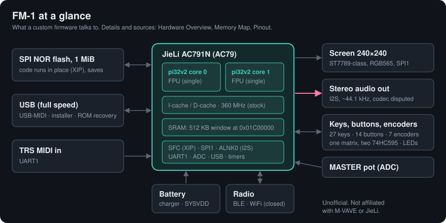

# FM-1 Firmware Developers' Wiki

An unofficial, community-written reference for people writing custom firmware for the M-VAVE FM-1 and SMK-37
(JieLi AC79 chip): the hardware, the boot chain and package format, installing and recovering, and how to write
firmware that runs well on it. Not affiliated with, endorsed by or supported by M-VAVE or JieLi.

Every technical fact is tagged with where it comes from: **[HW]** measured on a unit, **[SDK]** JieLi's SDK,
**[RE]** reverse engineering, **[CODE]** used by working firmware, **[?]** unverified. Start at
[Home](docs/Home.md).

## Contents

**Start**
- [Getting Started](docs/Getting-Started.md)
- [Choosing a Base](docs/Choosing-a-Base.md)
- [Recovery](docs/Recovery.md)

**Hardware**
- [Hardware Overview](docs/Hardware-Overview.md)
- [Memory Map](docs/Memory-Map.md)
- [Clocks and Power](docs/Clocks-and-Power.md)
- [Pinout](docs/Pinout.md)
- [Audio Output](docs/Audio-Output.md)
- [Display](docs/Display.md)
- [Controls](docs/Controls.md)
- [MIDI and USB](docs/MIDI-and-USB.md)
- [SMK-37](docs/SMK-37.md)

**Boot and install**
- [Boot Chain and Bootloaders](docs/Boot-Chain-and-Bootloaders.md)
- [Firmware Package Format](docs/Firmware-Package-Format.md)
- [Update Protocol and Installers](docs/Update-Protocol-and-Installers.md)
- [Flash Storage](docs/Flash-Storage.md)

**Writing firmware**
- [Programming Guide](docs/Programming-Guide.md)
- [Performance](docs/Performance.md)
- [Second Core](docs/Second-Core.md)
- [Debugging](docs/Debugging.md)
- [Simulators and Emulators](docs/Simulators-and-Emulators.md)

**Community**
- [Known Projects](docs/Known-Projects.md)
- [Tools](docs/Tools.md)
- [Open Questions](docs/Open-Questions.md)
- [Glossary](docs/Glossary.md)
- [Contributing](docs/Contributing.md)
- [License](docs/License.md)

## Contributing

Corrections and new findings are welcome as pull requests. Please read [Contributing](docs/Contributing.md)
first: a wrong fact, once written down, gets copied, so each one needs its source and its tag.

## Licence

Text: [CC BY-SA 4.0](https://creativecommons.org/licenses/by-sa/4.0/). New code sketches: CC0. Excerpts from other
projects keep their own licences. See [License](docs/License.md).
